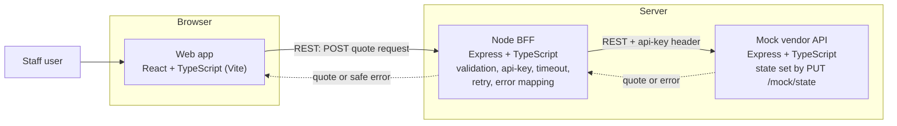
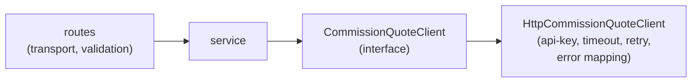

# Commission Quote

A web app where bank lending staff enter loan details and get a commission quote. The quote comes from a third-party vendor API, which is not ready yet, so the app is built against a mock of it.

## Docs

- [commission-quote-raw-requirement.md](docs/specs/commission-quote-raw-requirement.md): the original brief
- [analysis.md](docs/specs/analysis.md): open questions, stack decision, trade-offs, evolution path
- [plan.md](docs/specs/plan.md): what is built and what is planned (web, BFF, mock, e2e, logging, CI, Docker, CD)

## What it is

In a bank lending platform, staff often need commission quotes for loan applications. An external vendor API calculates the commission. That API is still under construction, but its contract and authentication are final.

The project has three parts:

- **Web app** (`apps/web`): a form for `loanAmount`, `loanTermInMonths` and `riskBand` (`LOW`, `MEDIUM`, `HIGH`). **Generate Quote** shows the `quoteId`, `commissionRate` and `totalCommission`. It has loading states and clear messages for invalid input and failed requests.
- **BFF** (`apps/bff`): a small Node server between the browser and the vendor. It validates the request, holds the `api-key`, calls the vendor, and turns vendor failures into safe errors.
- **Mock vendor** (`apps/mock-vendor`): follows the agreed contract. You pick its next response with `PUT /mock/state`, so every success and failure case can be reproduced on demand.

The original brief is in [commission-quote-raw-requirement.md](docs/specs/commission-quote-raw-requirement.md).

## High level design



The browser sends the loan details to the BFF. The BFF validates them, adds the `api-key` header and calls the vendor (the mock for now). It returns the quote, or a safe error. When the real vendor is ready, only the base URL and key change.

Inside the BFF the vendor call sits behind an interface, so it can be swapped or moved to another service later:



Main points:

- The `api-key` stays on the server. The browser only talks to the BFF.
- Input is validated in the UI and again in the BFF, with one shared schema (`apps/shared`). The BFF is the authority.
- Vendor failures (4xx, 5xx, timeout, bad response) become a fixed set of error codes with friendly messages. Vendor details are never sent to the browser.
- The BFF retries a failed vendor call once, and only there.

The behaviour, error mapping and mock responses are in [plan.md](docs/specs/plan.md).

## Analysis

Details for each item are in [analysis.md](docs/specs/analysis.md).

## Plan and status

| Area                                       | Status                                                                |
| ------------------------------------------ | --------------------------------------------------------------------- |
| Web app, BFF, mock vendor, shared schemas  | Done                                                                  |
| Unit and integration tests, Playwright e2e | Done (2 e2e scenarios)                                                |
| Logging, CI, Docker, CD                    | Planned, not implemented                                              |
| Code clean-up and refactoring              | Not done. The timebox was enough for the requirements, not for review |

Details for each item are in [plan.md](docs/specs/plan.md).

## How to run

You need Node.js and npm.

```
npm install
cp apps/bff/.env.example apps/bff/.env   # any dummy VENDOR_API_KEY works against the mock
npm start                                # mock vendor :5001, BFF :3000, web :5173
```

Open http://localhost:5173. Use `npm run dev` instead of `npm start` for watch mode.

Try the Bff API directly:

```
curl -X POST localhost:3000/api/commission-quotes \
  -H 'content-type: application/json' \
  -d '{"loanAmount":1000,"loanTermInMonths":12,"riskBand":"LOW"}'
```

Make the mock vendor API fail (use `201` to reset):

```
curl -X PUT localhost:5001/mock/state -H 'Content-Type: application/json' -d '{"stateId":"502"}'
```

Available states are `201`, `400`, `401`, `429`, `500`, `502` and `504`. You can add `"delay"` in milliseconds.

## How to test

```
npm run typecheck
npm test                                 # unit and integration tests (Vitest)
npx playwright install chromium          # once
npm run test:e2e                         # starts the three apps if they are not running
```

## Folder structure

```
.
├── README.md
├── AGENT.md                    # guidance for AI coding agents
├── package.json                # npm workspaces root
├── docs/specs/                 # requirement, analysis, plan
├── apps/
│   ├── web/                    # React + TypeScript (Vite)
│   ├── bff/                    # Express BFF
│   ├── mock-vendor/            # Express mock of the vendor API
│   └── shared/                 # zod schemas and types shared by web and BFF
└── e2e/                        # Playwright end-to-end tests
```

## AI Usage

- AI tool: Claude
- Analysis: mine; AI summarised it in `analysis.md`.
- Implementation plan (`plan.md`): mine; AI reworded and restructured it.
- Coding patterns: mine. Code generation: AI.
- Workflow: AI writes tests, I review and approve, then AI writes the code. I direct refactoring or do it myself.
